# IATO v7: Stage 2 Translation and TLB Maintenance

IATO v7 is the Arm virtualisation component of the IATO series. It defines, verifies and implements Stage 2 address translation and TLB maintenance for a hypervisor executing at EL2: a Sail model serves as the normative reference, a TLA+ specification verifies the unmap sequence, and the SystemVerilog implementation is validated against the reference by automated cross check. It is not a complete hypervisor or MMU: coverage is limited to the scope listed below, and all results come from simulation and open tool synthesis, with no physical FPGA or silicon measurement. The companion repository, [IATO](https://github.com/whatheheckisthis/Intent-Auditable-Trust-Object), covers coherence, PCIe ordering and DMA; together the two repositories apply one method: state the required behaviour first, then design, verify and measure against it. All numerical results in this document are produced by `./scripts/check.sh` and `./bench/run.sh` at release v0.2.0, except where a section states that a value comes from the captures workflow, and CI repeats every check on each push and pull request. The schematics, waveforms and tool screenshots in [Figures](#figures) are generated in CI by the captures workflow.

The key words MUST, MUST NOT, SHALL, SHOULD and MAY in this document are to be interpreted as described in BCP 14 (RFC 2119 and RFC 8174).

## Contents

- [Key features](#key-features)
- [Scope](#scope)
- [Architecture](#architecture)
- [Repository layout](#repository-layout)
- [Requirements](#requirements)
- [Build](#build)
- [Usage](#usage)
- [Configuration](#configuration)
- [Verification and testing](#verification-and-testing)
- [Figures](#figures)
- [Security](#security)
- [License](#license)

## Key features

IATO v7 has four parts. Each part pairs a normative statement of the required behaviour with an artefact that runs: RTL in simulation and synthesis, a TLA+ model under TLC, or a Sail model compiled to C.

| # | Feature | What runs | Checked by |
|---|---|---|---|
| 1 | [Stage 2 walker RTL](#1-stage-2-walker-rtl) | `rtl/s2_walker.sv` under Verilator | Sail reference, Python walker, Verilator cross check, Yosys |
| 2 | [Stage 2 TLB RTL](#2-stage-2-tlb-rtl) | `rtl/s2_tlb.sv` under Icarus Verilog | Icarus testbench, Sail TLBI scope assertions, Yosys |
| 3 | [TLBI and S2Unmap ordering (TLA+)](#3-tlbi-and-s2unmap-ordering-tla) | `spec/tla/S2Unmap.tla`, three configurations | TLC |
| 4 | [Sail architectural models](#4-sail-architectural-models) | `spec/sail/stage2.sail`, `spec/sail/tlbi_scope.sail` compiled to C | Sail assertions, Python walker |

Each requirement carries an identifier, such as `S2-W-03`. Each requirement maps to at least one automated check, listed in the "Verified by" column of its table.

### 1. Stage 2 walker RTL

- A Stage 2 table walker for a 4 KiB granule, 48 bit IPA and start level 0, with one table read in flight (`rtl/s2_walker.sv`).
- Translation, access flag and permission faults, with the same result encoding as the Sail reference.
- Cross checked against Sail and an independent Python walker over random tables (`tools/s2_vectors.py`, `sim/tb_s2_walker.cpp`).

Stage 2 walker requirements:

| ID | Requirement | Verified by |
|---|---|---|
| S2-W-01 | The walker SHALL resolve a 48 bit IPA from the VTTBR_EL2 base in at most four levels, indexing nine IPA bits per level. | Walker cross check |
| S2-W-02 | The walker SHALL raise a translation fault, with its level, on an invalid descriptor. | Walker cross check |
| S2-W-03 | The walker SHALL treat a block descriptor at level 0, and descriptor type 0b01 at level 3, as reserved and raise a translation fault. | Walker cross check |
| S2-W-04 | The walker SHALL raise an access flag fault when AF is clear. It SHALL NOT update AF. | Walker cross check |
| S2-W-05 | The walker SHALL grant reads only when S2AP[0] is set, and writes only when S2AP[1] is set. Otherwise it SHALL raise a permission fault. | Walker cross check, planted fault |
| S2-W-06 | The walker SHALL return the same result encoding as the Sail reference: bit 63 fault, bits 62 to 60 kind, bits 59 to 58 level, bits 47 to 0 output address. | Walker cross check |

The probe generator, `tools/s2_vectors.py`, builds random tables with pages, 2 MiB blocks, 1 GiB blocks, invalid descriptors, reserved descriptors, AF clear and every S2AP value. It then probes addresses inside and outside each mapping. The Sail reference, the Python walker and the RTL MUST agree on every probe.

### 2. Stage 2 TLB RTL

- Stage 2 only and combined TLB entries tagged by VMID and ASID (`rtl/s2_tlb.sv`).
- Broadcast TLBI IPAS2E1IS, VMALLE1IS, VMALLS12E1IS and VAE1IS with the scopes defined in `spec/sail/tlbi_scope.sail`.
- Directed Icarus Verilog testbench with 13 checks (`rtl/tb/tb_s2_tlb.sv`).

TLBI scope requirements:

| ID | Operation | The TLB SHALL remove |
|---|---|---|
| S2-T-01 | IPAS2E1IS | Stage 2 only entries of the VMID for the IPA page |
| S2-T-02 | VMALLE1IS | Combined entries of the VMID |
| S2-T-03 | VMALLS12E1IS | All entries of the VMID |
| S2-T-04 | VAE1IS | Combined entries of the VMID for the VA page, with a matching ASID or the global attribute |
| S2-T-05 | Any operation | No entry of any other VMID |

Lookups SHALL match on VMID. Combined lookups SHALL also match on ASID unless the entry is global. The Sail definition and `s2_tlb.sv` are verified against the same cases.

### 3. TLBI and S2Unmap ordering (TLA+)

- Unmap ordering for one IPA page across two cores (`spec/tla/S2Unmap.tla`).
- One configuration for the required sequence and one for each incorrect ordering (`spec/tla/*.cfg`).
- The safety property `NoUseAfterFree`, checked by TLC.

Unmap sequence requirements:

| ID | Requirement | Verified by |
|---|---|---|
| S2-U-01 | A hypervisor removing an IPA page from a guest SHALL clear the descriptor, issue DSB, issue TLBI IPAS2E1IS, issue DSB, issue TLBI VMALLE1IS and issue DSB before it frees the frame. | `S2Unmap` |
| S2-U-02 | The hypervisor SHALL NOT omit TLBI VMALLE1IS. TLBI IPAS2E1IS does not remove combined entries. | `S2Unmap_no_vmalle1` |
| S2-U-03 | The hypervisor SHALL NOT issue TLBI VMALLE1IS before TLBI IPAS2E1IS has completed. A core can refill a combined entry from a cached Stage 2 entry in between. | `S2Unmap_vmalle1_first` |

The model contains two cores. Each core can cache a Stage 2 entry and a combined entry, and can refill a combined entry from a cached Stage 2 entry without reading the tables. Broadcast TLBIs complete at the next DSB. The safety property `NoUseAfterFree` states that no guest access reaches the frame after it is freed.

| Configuration | Sequence | Result |
|---|---|---|
| `S2Unmap` | clear, DSB, IPAS2E1IS, DSB, VMALLE1IS, DSB, free | Holds, 74 states |
| `S2Unmap_no_vmalle1` | clear, DSB, IPAS2E1IS, DSB, free | Violated: a combined entry survives the free |
| `S2Unmap_vmalle1_first` | clear, DSB, VMALLE1IS, DSB, IPAS2E1IS, DSB, free | Violated: a combined entry is refilled after VMALLE1IS |

Instruction order is therefore a correctness requirement, not an optimisation.

### 4. Sail architectural models

- The Stage 2 walk (`spec/sail/stage2.sail`), which is the normative reference for all walker checks.
- The TLBI scope definitions (`spec/sail/tlbi_scope.sail`) with 8 executable assertions (`spec/sail/checks.sail`).
- Both are compiled to C by `scripts/build_sim.sh`; `sim/s2_ref.c` runs the Sail walk over the generated probes.

## Scope

In scope:

- Stage 2 translation with a 4 KiB granule, 48 bit IPA and start level 0.
- Table, block and page descriptors; translation, access flag and permission faults.
- Stage 2 only and combined TLB entries tagged by VMID and ASID.
- TLBI IPAS2E1IS, VMALLE1IS, VMALLS12E1IS and VAE1IS.
- Unmap ordering for one IPA page across two cores.

Out of scope:

- 16 KiB and 64 KiB granules, and concatenated start tables.
- Hardware access flag and dirty state update (FEAT_HAFDBS).
- Stage 1 translation, which is modelled only as a source of combined entries.
- Range TLBI operations and FEAT_TLBIOS variants.
- Multi page unmap, and break before make on live remapping.

Known limitations:

- All results come from simulation and open tool synthesis. No physical FPGA or silicon measurement has been performed.
- The TLA+ model covers one IPA page and two cores. It does not model memory ordering beyond DSB completion.
- The walker and TLB are synthesised as separate blocks. Integrated timing has not been measured.
- Synthesis figures are open tool estimates on a small FPGA. They are not vendor tool or ASIC figures.

Architectural behaviour follows ARM DDI 0487K. Sources are listed in [docs/references.md](docs/references.md).

Planned work (not implemented):

1. Cross check the walker and TLBI scopes against a QEMU TCG guest at EL2.
2. Overlap walks and cache level 0 to 2 descriptors, then measure the gain at latency 32.
3. Support concatenated start tables and a 40 bit IPA with start level 1.
4. Implement hardware access flag and dirty state update (FEAT_HAFDBS).
5. Integrate the walker, TLB and TLBI unit, then synthesise them as one block.

## Architecture

```
   guest (EL1)                    hypervisor (EL2)                   verified by
  -------------                  ------------------                 -------------
  VA --stage 1--> IPA
                   |
                   v
           +---------------+  miss   +----------------+  4 reads   +-------------------+
           | s2_tlb.sv     |-------> | s2_walker.sv   |----------> | Stage 2 tables    |
           | S2 only and   |  fill   | L0 L1 L2 L3    | <--------- | in memory         |
           | combined, by  | <------ | faults: trans, |   desc     | VTTBR_EL2 base    |
           | VMID and ASID |         | AF, permission |            +-------------------+
           +---------------+         +----------------+
                   ^                         |                     Sail stage2.sail
                   | TLBI IPAS2E1IS          v PA or fault         s2_vectors.py, s2_ref.c
                   | TLBI VMALLE1IS                                tb_s2_walker (Verilator)
                   | TLBI VMALLS12E1IS
                   | TLBI VAE1IS                                   Sail tlbi_scope.sail
                   |                                               tb_s2_tlb (Icarus)
           +------------------------------------------------+
           | unmap: clear desc, DSB, IPAS2E1IS, DSB,        |      S2Unmap.tla
           |        VMALLE1IS, DSB, free frame              |      three configurations
           +------------------------------------------------+
```

## Repository layout

```
spec/sail/       stage2.sail, tlbi_scope.sail, checks.sail, main.sail
spec/tla/        S2Unmap.tla and three configurations
rtl/             s2_walker.sv, s2_tlb.sv
rtl/tb/          tb_s2_tlb.sv (Icarus)
sim/             tb_s2_walker.cpp (Verilator), s2_ref.c (Sail harness)
tools/           s2_vectors.py
bench/           run.sh, synth.sh, results/
scripts/         check.sh, build_sim.sh
docs/            references.md, RESULTS.md
docs/capture/    capture.sh and helpers used by the captures workflow
docs/screenshots/ figures and run logs produced by the captures workflow
.github/workflows/ check.yml (all checks), captures.yml (figures)
```

### Version history

| Version | Content |
|---|---|
| v0.2.0 | Stage 2 reference model, unmap verification, walker and TLB implementation, cross check and synthesis |
| v0.1.0 | Lean 4 specification review against DDI 0487K, DDI 0608A, KVM and QEMU. Preserved at tag `archive/lean-v0.1.0` |

## Requirements

- Java 11 or later (CI uses Temurin 21), for TLC.
- Python 3.
- Sail 0.20 with libgmp (CI uses Sail 0.20.3).
- A C compiler.
- Icarus Verilog and Verilator.
- Optional: Yosys and nextpnr-ecp5, which enable synthesis.

CI installs these on `ubuntu-24.04`; see [.github/workflows/check.yml](.github/workflows/check.yml). Other platforms have not been tested.

The captures workflow, [.github/workflows/captures.yml](.github/workflows/captures.yml), additionally installs GTKWave, Geany, Xvfb, Openbox, xterm, xdotool, ImageMagick, librsvg and netlistsvg (npm). These tools are required only to regenerate the figures.

## Build

`scripts/build_sim.sh` compiles the Sail reference to C (`build/s2_ref`, `build/sail_checks`) and builds the Verilator walker harness (`build/obj_w/tb_s2_walker`). `scripts/check.sh` and `bench/run.sh` call it, so a separate build step is not required. If `tools/tla2tools.jar` is absent, `scripts/check.sh` downloads TLA+ tools v1.8.0 into `tools/`.

## Usage

```
./scripts/check.sh    # model checking, Sail assertions, cross check, RTL tests, synthesis
./bench/run.sh        # five seed cross check and latency sweep
./bench/synth.sh      # ECP5 synthesis only
```

`bench/run.sh` writes `bench/results/s2_walker.csv`. `bench/synth.sh` writes `bench/results/synth_ecp5.csv`.

## Configuration

- `TLA_JAR`: path to `tla2tools.jar` used by `scripts/check.sh`. The default is `tools/tla2tools.jar`.
- `tools/s2_vectors.py [seed] [probes]`: the defaults are seed 1 and 400 probes.
- `build/obj_w/tb_s2_walker [latency]`: memory latency in cycles; the default is 1.

## Verification and testing

`check.sh` exits non zero if any passing configuration fails, or if either incorrect unmap ordering fails to violate `NoUseAfterFree`. The synthesis step runs only when `yosys` is on the path. Full result tables are in [docs/RESULTS.md](docs/RESULTS.md).

### Verification summary

| Area | Artefact | Method | Result |
|---|---|---|---|
| Stage 2 reference | `spec/sail/stage2.sail` | Sail compiled to C | Reference for all walker checks |
| Walker conformance | `rtl/s2_walker.sv` | 10,000 random probes across five table sets, compared with Sail and an independent Python walker | 0 mismatches. A planted permission fault produces 330 mismatches in 2,000 probes |
| Unmap ordering | `spec/tla/S2Unmap.tla` | TLC model checking, three configurations | The required sequence holds over 74 states. Both incorrect orderings violate `NoUseAfterFree` |
| TLBI scope | `spec/sail/tlbi_scope.sail`, `rtl/s2_tlb.sv` | 8 Sail assertions, 13 directed RTL checks | Pass |
| Synthesis | `bench/synth.sh` | Yosys and nextpnr, Lattice ECP5 LFE5U-25F | Walker 370 LUT4 at 236.57 MHz. 8 entry TLB 3,246 LUT4 at 136.72 MHz |

### Walk latency

The walker holds one table read in flight. A full walk costs 1 + 4 x (latency + 1) cycles.

| Memory latency (cycles) | Mean cycles per walk, all probes | Four level walk |
|---|---|---|
| 1 | 6.22 | 9 cycles |
| 8 | 24.49 | 37 cycles |
| 32 | 87.11 | 133 cycles |

Seed 1, 2,000 probes. The mean is lower than the four level figure because most faulting probes terminate at an early level.

### Synthesis

Yosys `synth_ecp5`, then nextpnr out of context on a Lattice LFE5U-25F, seed 1.

| Module | LUT4 | FF | Carry | Post route Fmax |
|---|---|---|---|---|
| s2_walker | 370 | 143 | 0 | 236.57 MHz |
| s2_tlb | 3,246 | 859 | 0 | 136.72 MHz |

The TLB implements a fully associative compare across eight entries with four TLBI match rules, which accounts for most of its logic.

### Results of the captures run

The captures workflow ([run 44443806309](https://github.com/whatheheckisthis/Intent-Auditable-Trust-Object-V7/actions/runs/44443806309), commit `3fd6839`) repeated the checks on `ubuntu-24.04` with the tool versions below. The raw output of every run is kept in [docs/screenshots/](docs/screenshots/) as `.log` files beside the figures.

| Check | Tool | Result | Figure |
|---|---|---|---|
| `S2Unmap` | TLC (`tla2tools.jar` from the v1.8.0 release, reporting version 2026.11.15.002146), Temurin 21.0.13 | No error found; 435 states generated, 74 distinct states, depth 8 | 7 |
| `S2Unmap_no_vmalle1` | TLC | `NoUseAfterFree` violated; 8 state counterexample; 72 distinct states | 8 |
| `S2Unmap_vmalle1_first` | TLC | `NoUseAfterFree` violated; 11 state counterexample; 89 distinct states | 9 |
| TLBI scope assertions | Sail 0.20.3 | `PASS sail tlbi scope` (8 assertions) | 10 |
| Sail Stage 2 walk against the Python walker | Sail 0.20.3 | Seeds 1 to 5, 2,000 probes each, 0 mismatches | 10 |
| `tb_s2_tlb` | Icarus Verilog 12.0 | `PASS tb_s2_tlb` | 3a |
| `s2_walker` against Sail-checked vectors, seed 1 | Verilator 5.020 | 2,000 probes, 0 mismatches at memory latencies 1, 8 and 32; 6.22, 24.49 and 87.11 mean cycles per walk; four level walks at 9, 37 and 133 cycles | 3b |
| Lint | Verilator 5.020 | `rtl/s2_walker.sv` and `rtl/s2_tlb.sv` clean with `-Wall -Wno-UNUSEDSIGNAL` | 11 |
| ECP5 synthesis | Yosys 0.33, nextpnr-ecp5 0.6 | `s2_walker` 296 LUT4, 143 FF, 0 carry, 213.95 MHz; `s2_tlb` 3,198 LUT4, 859 FF, 16 carry, 92.58 MHz | 11 |

The walker, TLB, TLC and Sail results match the tables above. The synthesis results do not: the committed figures in [Synthesis](#synthesis) and `bench/results/synth_ecp5.csv` are reproduced exactly by Yosys 0.52 with nextpnr-ecp5 0.7, whereas the Ubuntu 24.04 packages used in CI (Yosys 0.33, nextpnr-ecp5 0.6) map and route the same RTL to the different results shown above. Open tool synthesis results depend on the tool version, and any comparison SHOULD state the versions used.

## Figures

All figures are generated by [`.github/workflows/captures.yml`](.github/workflows/captures.yml) on an `ubuntu-24.04` runner from the sources in this repository, using [`docs/capture/capture.sh`](docs/capture/capture.sh). Schematics are drawn by Yosys and netlistsvg; every other figure is a screenshot of the named tool running on an Xvfb display. No figure is drawn by hand or edited beyond cropping. The design is digital RTL throughout; the repository contains no microcontroller firmware and no analog or mixed-signal blocks. Select any figure to open it at full resolution.

| Figure | Subject | Tool | Source |
|---|---|---|---|
| 1 | `s2_walker` schematic | Yosys 0.33, netlistsvg | `rtl/s2_walker.sv` |
| 2 | `s2_tlb` schematic, `N = 2` | Yosys 0.33, netlistsvg | `rtl/s2_tlb.sv` |
| 3 | Testbenches open in the editor, simulation log below | Geany, Icarus Verilog 12.0, Verilator 5.020 | `rtl/tb/tb_s2_tlb.sv`, `sim/tb_s2_walker.cpp` |
| 4 | `tb_s2_tlb` waveform | GTKWave | `rtl/tb/tb_s2_tlb.sv` |
| 5 | `s2_walker` waveform, memory latency 1 | Verilator 5.020, GTKWave | `docs/capture/tb_s2_walker_vcd.cpp` |
| 6 | `s2_walker` waveform, memory latency 8 | Verilator 5.020, GTKWave | `docs/capture/tb_s2_walker_vcd.cpp` |
| 7 | TLC, required unmap sequence | TLC, Temurin 21 | `spec/tla/S2Unmap.cfg` |
| 8 | TLC, VMALLE1IS omitted | TLC, Temurin 21 | `spec/tla/S2Unmap_no_vmalle1.cfg` |
| 9 | TLC, VMALLE1IS issued first | TLC, Temurin 21 | `spec/tla/S2Unmap_vmalle1_first.cfg` |
| 10 | Sail checks | Sail 0.20.3 | `spec/sail/`, `sim/s2_ref.c` |
| 11 | Lint and ECP5 synthesis | Verilator 5.020, Yosys 0.33, nextpnr-ecp5 0.6 | `docs/capture/lint_synth.sh`, `bench/synth.sh` |

### Schematics

Each schematic is the RTL-level netlist after Yosys `proc`, `opt -full` and `clean`, before technology mapping, so cells correspond to RTL operators and registers rather than ECP5 primitives. Figure 2 sets the TLB parameter `N` to 2 with `chparam` so that the per entry structure is legible. The default eight entry TLB has 263 cells; its netlist is too large to read inline and is published as a zoomable [SVG](docs/screenshots/schematic_s2_tlb.svg). Cell counts are in [`docs/screenshots/schematic_stat.log`](docs/screenshots/schematic_stat.log).

<p align="center">
  <a href="docs/screenshots/schematic_s2_walker.png">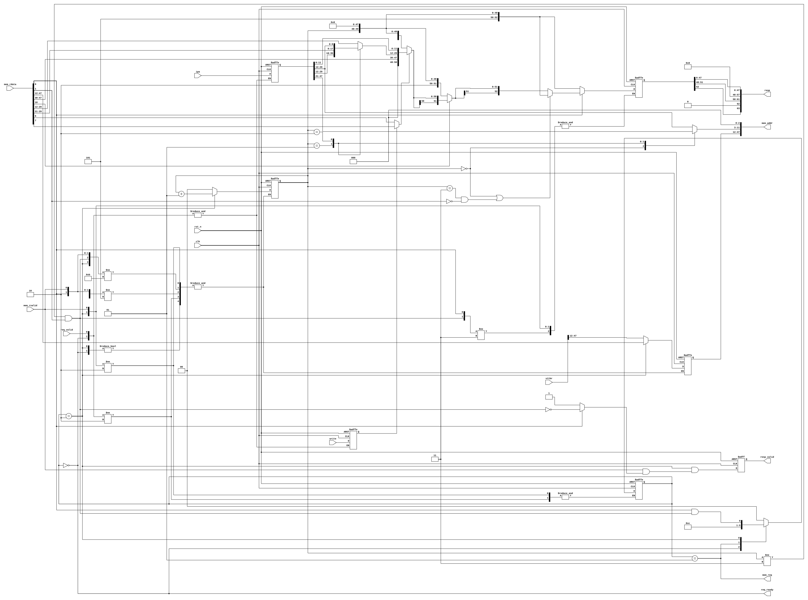</a>
  <br>
  <sub><b>Figure 1.</b> Stage 2 walker, 45 cells. Seven registers hold the walk state, level, table base, IPA, access type, response and response valid; multiplexers select the nine IPA index bits for each level and the output address for level 1, 2 and 3 leaves; comparators on the descriptor bits drive the translation, access flag and permission fault responses. <a href="docs/screenshots/schematic_s2_walker.svg">SVG</a></sub>
</p>

<p align="center">
  <a href="docs/screenshots/schematic_s2_tlb_n2.png">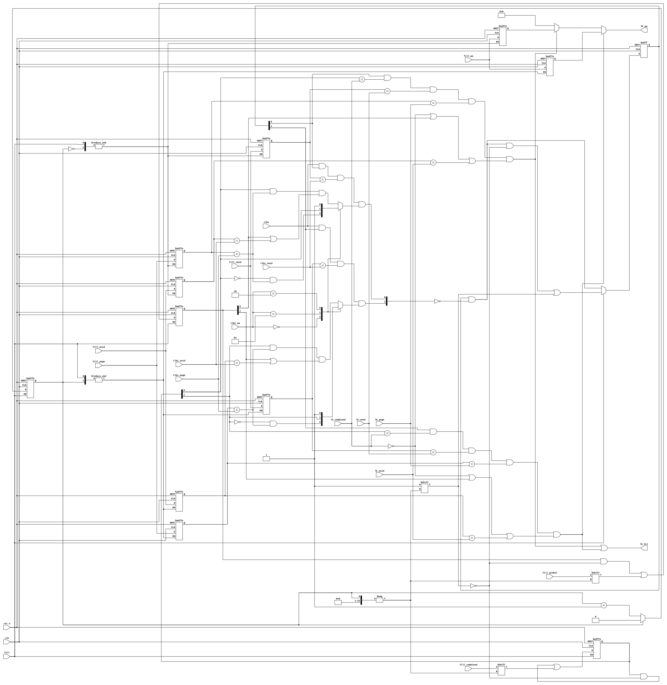</a>
  <br>
  <sub><b>Figure 2.</b> Stage 2 TLB with <code>N = 2</code>, 82 cells: per entry valid, combined, global, VMID, ASID, page and PA registers; the VMID, page and ASID comparators that drive <code>lk_hit</code> and select <code>lk_pa</code>; the TLBI kill logic decoded from <code>tlbi_op</code>; and the round robin fill pointer. <a href="docs/screenshots/schematic_s2_tlb_n2.svg">SVG</a></sub>
</p>

### Simulation, lint and synthesis

Figure 3 shows the testbenches open as editor tabs above a terminal in which [`docs/capture/run_tbs.sh`](docs/capture/run_tbs.sh) runs them. Icarus Verilog 12.0 compiles and runs `tb_s2_tlb`, which prints `PASS`. The `sorry: Case unique/unique0 qualities are ignored` line is an Icarus warning on `rtl/s2_tlb.sv`; Verilator lints the same file clean (Figure 11). The Sail reference then checks the seed 1 probes against the Python walker, and the Verilator walker harness checks the RTL against the same probes at memory latencies 1, 8 and 32, with 0 mismatches in each run. The full log is in [`docs/screenshots/sim.log`](docs/screenshots/sim.log).

<p align="center">
  <a href="docs/screenshots/testbench_1-tb_s2_tlb.png">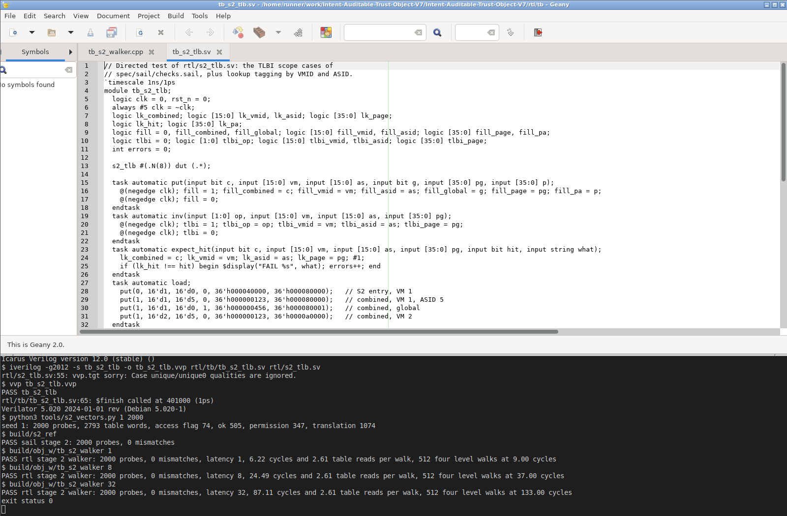</a>
  <br>
  <sub><b>Figure 3a.</b> <code>tb_s2_tlb.sv</code> active: TLB fills tagged by VMID and ASID, lookups, and the four TLBI scopes, with the run log below.</sub>
</p>

<p align="center">
  <a href="docs/screenshots/testbench_2-tb_s2_walker.png">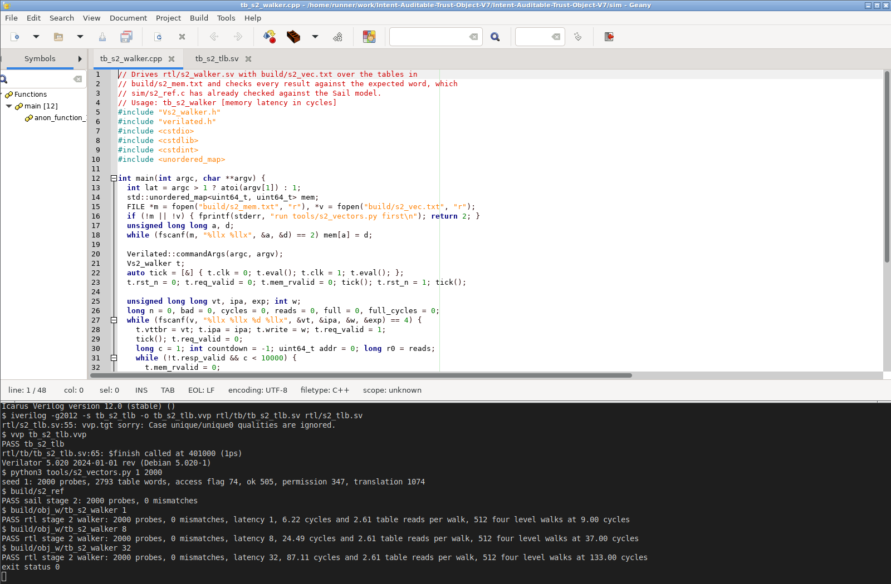</a>
  <br>
  <sub><b>Figure 3b.</b> <code>tb_s2_walker.cpp</code> active: the Verilator harness that drives <code>s2_walker</code> with the generated probes, models table memory with a configurable latency and compares every response with the expected word.</sub>
</p>

The waveforms are recorded without changing the RTL or the testbenches. For `tb_s2_tlb`, `run_tbs.sh` compiles a separate module containing only `$dumpfile` and `$dumpvars` as a second top level. For `s2_walker`, [`docs/capture/tb_s2_walker_vcd.cpp`](docs/capture/tb_s2_walker_vcd.cpp) is a copy of the Verilator harness with identical stimulus and checks, built with `--trace`, which writes a VCD of the first 120 cycles; it reports the same `PASS` result as the original harness.

<p align="center">
  <a href="docs/screenshots/waveform_tb_s2_tlb.png">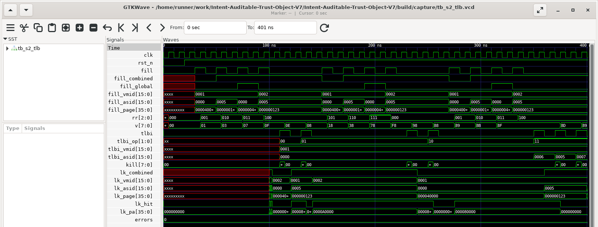</a>
  <br>
  <sub><b>Figure 4.</b> <code>tb_s2_tlb</code>: four fills (a Stage 2 entry of VMID 1, a combined entry of VMID 1 and ASID 5, a global combined entry, and a combined entry of VMID 2) set <code>v</code> to <code>0F</code>; lookups follow, then TLBI operations 0 to 3 (IPAS2E1IS, VMALLE1IS, VMALLS12E1IS, VAE1IS), each of which asserts <code>kill</code> for the entries in its scope. The testbench refills the TLB between scopes. <code>errors</code> remains 0.</sub>
</p>

<p align="center">
  <a href="docs/screenshots/waveform_s2_walker_lat1.png">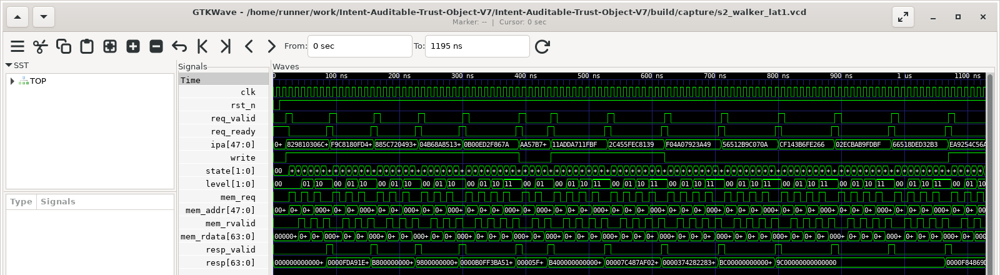</a>
  <br>
  <sub><b>Figure 5.</b> <code>s2_walker</code> at memory latency 1, first 120 cycles of the seed 1 probes: each request raises <code>mem_req</code> once per level, <code>level</code> advances from 0 towards 3, and <code>resp_valid</code> pulses for one cycle with the output address or fault word in <code>resp</code>.</sub>
</p>

<p align="center">
  <a href="docs/screenshots/waveform_s2_walker_lat8.png">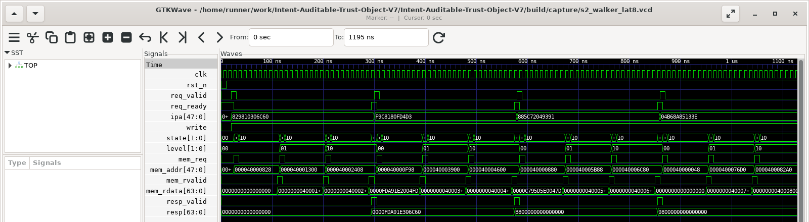</a>
  <br>
  <sub><b>Figure 6.</b> <code>s2_walker</code> at memory latency 8: each table read waits for <code>mem_rvalid</code>. The three probes shown each end at level 2, with a 2 MiB block translation (<code>0000FDA91E306C60</code>), a permission fault (<code>B800000000000000</code>) and a translation fault (<code>9800000000000000</code>), using the result encoding of S2-W-06.</sub>
</p>

### Model checking and Sail

Figures 7 to 9 show [`docs/capture/tlc_run.sh`](docs/capture/tlc_run.sh) running TLC on each configuration of `S2Unmap.tla` with `-difftrace`, so that each counterexample state after the first lists only the variables that changed. Parser progress lines are filtered out; all other lines are TLC output as printed. In the model, `pteHyp` is the descriptor as written by the hypervisor and `pte` the descriptor as seen by the walkers, which takes the written value at each DSB; `S2` and `CB` denote a cached Stage 2 entry and a combined entry, `pend` holds broadcast TLBIs that complete at the next DSB, and `bad` records a guest access to the freed frame.

<p align="center">
  <a href="docs/screenshots/terminal_tlc_S2Unmap.png">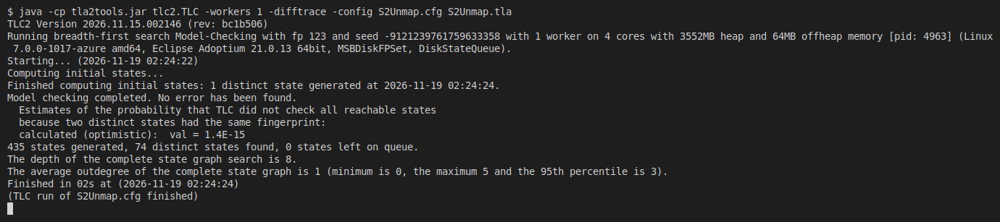</a>
  <br>
  <sub><b>Figure 7.</b> Required sequence (S2-U-01): model checking completes with no error; 435 states generated, 74 distinct states, depth 8.</sub>
</p>

<p align="center">
  <a href="docs/screenshots/terminal_tlc_S2Unmap_no_vmalle1.png">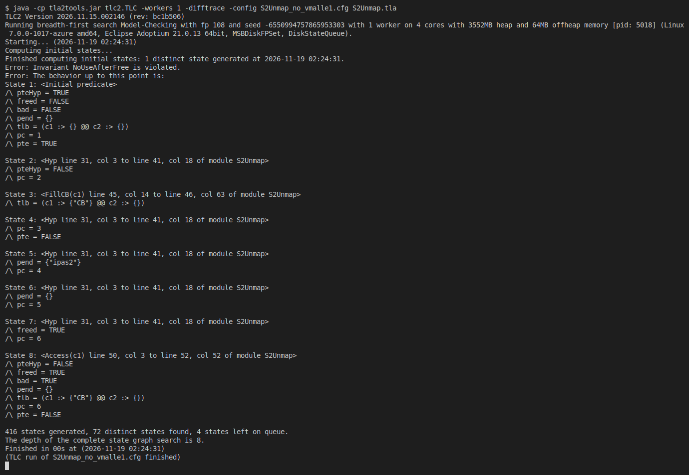</a>
  <br>
  <sub><b>Figure 8.</b> VMALLE1IS omitted (S2-U-02): <code>NoUseAfterFree</code> is violated. After the hypervisor clears the descriptor, and before the DSB makes the cleared descriptor visible to the walkers, core <code>c1</code> fills a combined entry; IPAS2E1IS completes at the next DSB without removing it, the frame is freed, and <code>Access(c1)</code> reaches the frame through the surviving combined entry.</sub>
</p>

<p align="center">
  <a href="docs/screenshots/terminal_tlc_S2Unmap_vmalle1_first.png">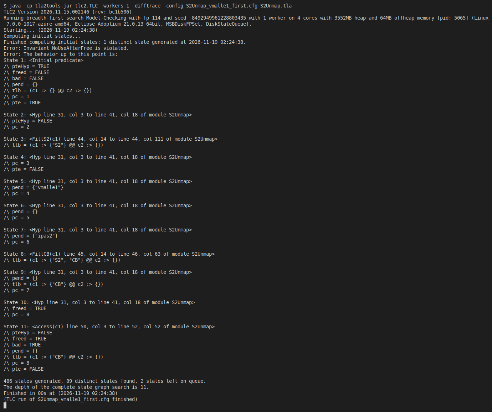</a>
  <br>
  <sub><b>Figure 9.</b> VMALLE1IS issued first (S2-U-03): <code>NoUseAfterFree</code> is violated. Core <code>c1</code> caches a Stage 2 entry before the cleared descriptor becomes visible; after VMALLE1IS completes and while IPAS2E1IS is pending, <code>FillCB(c1)</code> refills a combined entry from the cached Stage 2 entry, IPAS2E1IS then removes only the Stage 2 entry, and the guest access after the free uses the combined entry.</sub>
</p>

<p align="center">
  <a href="docs/screenshots/terminal_sail.png">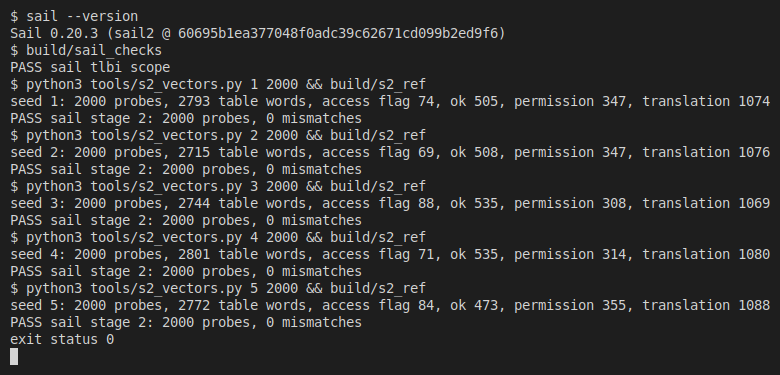</a>
  <br>
  <sub><b>Figure 10.</b> Sail 0.20.3: <code>build/sail_checks</code> passes the 8 TLBI scope assertions of <code>spec/sail/checks.sail</code>, and <code>build/s2_ref</code> runs the Sail Stage 2 walk over 2,000 probes for each of seeds 1 to 5 with 0 mismatches against the Python walker.</sub>
</p>

<p align="center">
  <a href="docs/screenshots/terminal_lint_synth.png">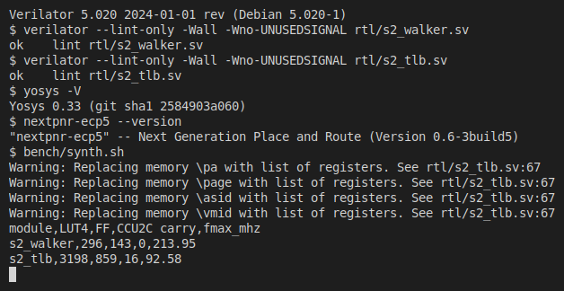</a>
  <br>
  <sub><b>Figure 11.</b> Verilator 5.020 lints both modules clean. <code>bench/synth.sh</code> with Yosys 0.33 and nextpnr-ecp5 0.6 reports <code>s2_walker</code> at 296 LUT4, 143 FF and 213.95 MHz, and <code>s2_tlb</code> at 3,198 LUT4, 859 FF, 16 CCU2C and 92.58 MHz; see <a href="#results-of-the-captures-run">Results of the captures run</a> for the comparison with the committed figures.</sub>
</p>

## Security

Commit verification and vulnerability reporting are described in [SECURITY.md](SECURITY.md); the maintainer signing key is in [KEYS.asc](KEYS.asc).

## License

Apache License 2.0. See [LICENSE](LICENSE).
